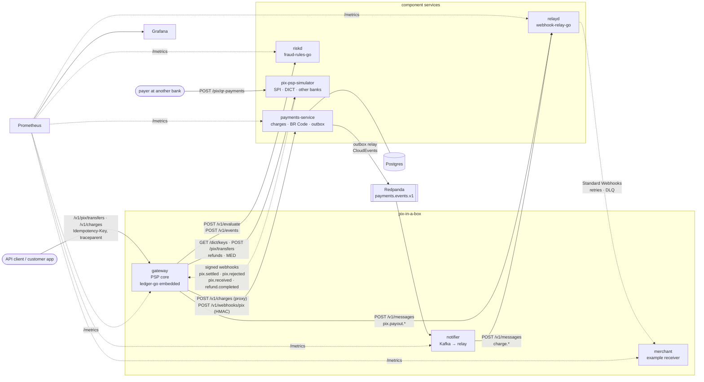
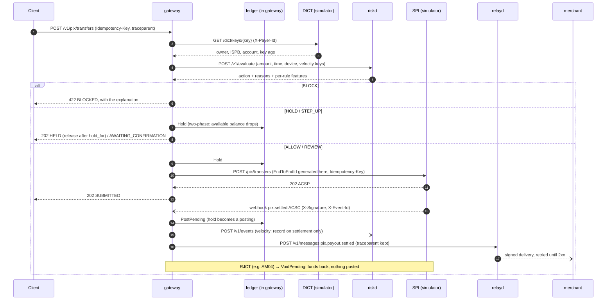

# pix-in-a-box

[](https://github.com/victorcondackdev/pix-in-a-box/actions/workflows/ci.yml)
[](https://github.com/victorcondackdev/pix-in-a-box/actions/workflows/e2e.yml)
[](LICENSE)

**A Pix PSP in a box, built from my open-source projects.** One
`docker compose up` starts a payment institution's core: customer wallets
on a double-entry ledger, outgoing Pix with real-time risk decisions and
two-phase holds, incoming Pix that settles merchant charges, devoluções and
MED, and merchant webhooks that survive outages. The SPI, the DICT and
the other banks are a simulator you can make misbehave on demand.

Every component is an independent repository with its own tests and
release. This one is the integration: the glue service that a PSP actually
has to write (`services/gateway`), the wiring, and a CI job that boots the
whole thing and proves five end-to-end scenarios on every push.

```
$ docker compose up -d --build --wait && ./scripts/demo.sh
━━ a) Happy path: Pix payout settled, merchant notified through relayd
   ✓ HTTP 202 (accepted, settlement is asynchronous)
   risk: REVIEW score 10 — rule beneficiary.new_key → REVIEW
   ✓ retry with the same Idempotency-Key replays the original transfer
   ✓ SPI settled it (ACSC); hold posted
   ✓ SPI chaos duplicates ignored on event ID (2 duplicate deliveries)
   ✓ relayd retried after the merchant's 503 (≥ 2 attempts, same webhook-id)
   ✓ one trace end to end: 26250d6b0c86fae63d248905bdb1707e (gateway → relayd → merchant)
━━ b) Account takeover at night: burst blocked by riskd, with the explanation
   ✓ HTTP 422 second transfer refused
   explanation of ato.new_device.night_drain:
     · age(payer.device.first_seen) = 15m
     · tx.time = 2026-11-22 02:33:00 -03:00
     · count(payer.transfers, 30m) = 1
...
━━ Books
   ✓ trial balance: debits = credits, posted and pending
   ✓ hash chain verifies and balances replay from entries
   ✓ ledger reserves reconcile with the SPI settlement account
all scenarios passed
```

## Architecture



### An outgoing Pix



## Components

| Component | Repository | Role here |
|---|---|---|
| gateway | this repo, [`services/gateway`](services/gateway) + [`internal/gateway`](internal/gateway) | PSP core: wallets, payouts, inbound Pix, refunds, MED, audit |
| notifier | this repo, [`services/notifier`](services/notifier) | payments-service events (Kafka) to merchant webhooks |
| merchant | this repo, [`services/merchant`](services/merchant) | example merchant backend verifying signatures |
| ledger | [ledger-go](https://github.com/victorcondackdev/ledger-go) | double-entry ledger library: holds, posts, voids, reversals, hash chain |
| risk | [fraud-rules-go](https://github.com/victorcondackdev/fraud-rules-go) | `riskd`: rule DSL, velocity features, explained decisions |
| SPI / DICT / other banks | [pix-psp-simulator](https://github.com/victorcondackdev/pix-psp-simulator) | async settlement, ISO reason codes, signed webhooks, devoluções, MED, chaos |
| charges | [payments-service-go](https://github.com/victorcondackdev/payments-service-go) | BR Code charges, idempotent settlement webhook, transactional outbox |
| webhooks | [webhook-relay-go](https://github.com/victorcondackdev/webhook-relay-go) | `relayd`: WAL, retries, DLQ, Standard Webhooks, SSRF guard |
| Pix rules | [brpay](https://github.com/victorcondackdev/brpay) | keys, EndToEndId, BR Code (used by the gateway, the simulator and payments-service) |
| ISO 20022 | [iso20022-pix-go](https://github.com/victorcondackdev/iso20022-pix-go) | pacs.008/002/004 models; not wired yet (the simulator speaks JSON), see below |

## Quick start

Requirements: Docker with Compose v2, `curl`, `jq`.

```sh
docker compose up -d --build --wait   # first build clones and compiles every component
./scripts/demo.sh                     # narrated scenarios; --assert stops at the first failure
open http://localhost:3000            # Grafana, dashboard "Pix in a Box"
docker compose down -v
```

| Service | Host port | |
|---|---|---|
| gateway | 8080 | the API below |
| merchant | 8070 | `GET /events` shows what the merchant received |
| payments-service | 8082 | |
| riskd | 8083 | `GET /v1/rulesets/active` |
| relayd | 8084 | bearer `relay-local-dev-token` |
| notifier | 8085 | `/metrics` |
| pix-psp-simulator | 8090 | dashboard at `/`, OpenAPI at `/openapi.json` |
| Prometheus, Grafana | 9090, 3000 | |

Unit tests and contract checks need no Docker: put the component
repositories next to this one (or let the script clone them) and run

```sh
CONTRACTS=1 scripts/workspace.sh ..   # writes a git-ignored go.work
go test -race ./...
scripts/check-contracts.sh
```

## The scenarios

`scripts/demo.sh` uses fresh customers and payees on every run, so it can
be re-run against the same stack. The risk clock is pinned with
`X-Sim-Time` (14:00 or 02:30 in São Paulo), so night rules behave the same
whatever hour CI runs at.

| | Scenario | What it demonstrates |
|---|---|---|
| a | Payout to a fresh key, settled; merchant down for the first delivery | DICT → risk → two-phase hold → SPI → signed webhook → post. `Idempotency-Key` replay; simulator chaos duplicates (`X-Sim-Webhook-Duplicates`) deduplicated on event ID; relayd retries the merchant's 503 with the same `webhook-id`; one `traceparent` from the API call to the merchant's log line. |
| b | Account takeover burst at 02:30 from a device seen 12 minutes ago | Velocity recorded on settlement only; the second transfer is blocked by `ato.new_device.night_drain` and the response carries every feature the rule read (device age, local time, 30-minute count). Nothing is held for a blocked transfer. |
| c | SPI rejects with `AM04` (`X-Sim-Fail`), 3 s settlement latency | Funds are unavailable while in flight (balance unchanged, available reduced), the RJCT voids the hold, the merchant is told why. |
| d | Full devolução of (a); partial devolução and MED on a scam payment | Full refund = ledger reversal linked to the original; partial = compensating posting (ledger-go reverses whole transactions only). MED walks OPEN → BLOCKED → ANALYSIS → REFUNDED, the FR01 return is booked, and the report becomes a fraud mark that riskd sees on the next Pix to that beneficiary. |
| e | A customer at another bank pays a merchant's QR charge | payments-service creates the static BR Code; the simulator settles it; the gateway credits the merchant in the ledger and calls payments-service's HMAC-signed webhook; the charge becomes PAID; the outbox publishes `payments.charge.paid.v1` to Redpanda; the notifier hands it to relayd; the merchant receives `charge.paid`. |
| | Books | Trial balance is zero (posted and pending), the hash chain and every balance verify by replay, and the ledger's reserves reconcile with the simulator's settlement account. |

## The gateway

### API

| Method and path | |
|---|---|
| `POST /v1/accounts` | open a customer wallet (limits, KYC date, initial deposit) |
| `GET /v1/accounts/{id}` | balance, available, held |
| `POST /v1/pix/transfers` | outgoing Pix; `202` in flight, `422` blocked or refused |
| `GET /v1/pix/transfers[/{id or EndToEndId}]` | status, risk explanation, ledger references, refunds |
| `POST /v1/pix/transfers/{id}/confirm` | complete a step-up challenge |
| `POST /v1/pix/transfers/{id}/release`, `/cancel` | analyst decision on a cautionary hold |
| `POST /v1/pix/transfers/{id}/refunds` | devolução (MD06, BE08, SL02), full or partial |
| `POST /v1/pix/transfers/{id}/med` | report fraud and run the MED case |
| `GET /v1/pix/received/{e2e}` | an inbound Pix and what happened to it |
| `POST /v1/charges`, `GET /v1/charges/{id}` | proxied to payments-service |
| `POST /v1/webhooks/spi` | the simulator's signed webhooks |
| `GET /v1/ledger/accounts/{id}/statement` | statement page with running balances (`include_holds=true`) |
| `GET /v1/ledger/trial-balance`, `GET /v1/ledger/verify` | global invariants, hash chain |
| `GET /v1/reconciliation/spi` | ledger reserves against the SPI balance |
| `GET /healthz`, `/readyz`, `/metrics` | `readyz` checks bootstrap and every dependency |

Every mutating `POST` requires `Idempotency-Key` (same key and body
replays the response with `Idempotent-Replayed: true`; same key and a
different body is `422`; concurrent duplicates get `409`). Errors are RFC
9457 problem documents carrying the trace ID.

### Ledger model

| Account | Type | |
|---|---|---|
| `spi:reserves` | asset | the PSP's settlement account at the SPI; opened from the simulator balance at start |
| `clearing:cash-in` | asset | deposits arriving through rails not modelled here |
| `equity:opening` | equity | opening balance |
| `customer:<id>` | liability, no overdraft | wallets |
| `merchant:<id>` | liability, no overdraft | merchants paid through charges |
| `suspense:pix-in` | liability | Pix received for a key nobody here owns |

| Event | Ledger operation |
|---|---|
| payout admitted (ALLOW, REVIEW, HOLD, STEP_UP) | `Hold` debit customer, credit reserves |
| ACSC | `PostPending` |
| RJCT, step-up expired, analyst cancel, never reached the SPI | `VoidPending` |
| full devolução of an untouched payout | `Reverse` of the posting |
| partial devolução, MED return | compensating `Post` credit customer, debit reserves |
| Pix received | `Post` debit reserves, credit merchant or suspense |

Every write carries an idempotency key derived from a business identifier
(`hold:<transfer>`, `post:<transfer>`, `pix-in:<EndToEndId>`,
`refund:<return id>`), so a duplicate webhook, a poll racing a webhook or a
retried request is a replay inside the ledger, not a second posting.

## Observability

- **Metrics.** Prometheus scrapes the gateway, riskd, relayd,
  payments-service, the notifier and the merchant. The provisioned
  dashboard ([`deploy/grafana/dashboards/pix.json`](deploy/grafana/dashboards/pix.json))
  shows payouts by status, risk decisions by action and the top rules, ledger
  transactions by kind, SPI webhook results, relayd attempts, failures and
  queue depths, the event pipeline (outbox, notifier, gateway notifications)
  and p95 latencies for the gateway API, each downstream service, rule
  evaluation, webhook attempts and settlement. Every metric name is checked
  against the exporter that defines it.
- **Screenshot.** `docs/grafana.png` is meant to hold a capture of the
  dashboard after a demo run (`docker compose up -d --build --wait &&
  ./scripts/demo.sh`, then open Grafana); it is not committed yet.
- **Tracing.** W3C `traceparent` is honoured or started at the gateway's
  edge, propagated on every outgoing call (with `X-Request-Id` set to the
  trace ID for services that log request IDs but not trace context), stored
  with each transfer so asynchronous work (webhooks, polls, timers) resumes
  the same trace, stored by relayd with each message and forwarded to the
  merchant. `docker compose logs | grep <trace id>` shows one Pix across the
  gateway, the simulator and the merchant. There is no trace exporter by
  design; swapping in the OpenTelemetry SDK is a change at the edges.
- **Logs.** JSON (`log/slog`) everywhere, with `trace_id` and `span_id` on
  every gateway, merchant and notifier line.

## How it is built

**Monorepo-style workspace over public repos.** The gateway imports
ledger-go, brpay, the simulator's `webhook` package and (in tests)
fraud-rules-go and webhook-relay-go. Most of them are not tagged yet, so
instead of pseudo-versions and `replace` directives the build assembles a
Go workspace: [`scripts/workspace.sh`](scripts/workspace.sh) uses sibling
checkouts when present and shallow-clones the rest (brpay at `v0.1.0`, the
others at `main`, every ref overridable). The Dockerfile and CI run the
same script; the generated `go.work` is git-ignored and is the only place
a local path ever appears. `go.mod` records the release versions, so the
switch to tagged modules is deleting the script.

**The notifier is its own module.** It is the only code with a third-party
dependency (franz-go), and isolating it keeps the gateway module buildable
and testable from the component repositories alone.

**Tests use the real engines.** The gateway's tests run fraud-rules-go's
engine with the PSP's actual ruleset and webhook-relay-go's engine and HTTP
API in-process, delivering to the real merchant receiver; only the
simulator and payments-service (whose packages are internal) are fakes,
written against their source and decoding as strictly as they do. The
night account-takeover scenario is a unit test before it is a demo step.

**Contract checks.** [`scripts/check-contracts.sh`](scripts/check-contracts.sh)
asserts, in a second and without containers, that every route the gateway
calls, every environment variable compose sets, the strictly-decoded JSON
fields, the simulator scenario fields, every metric the dashboard queries,
and every value that must agree across services (secrets, tokens, keys,
ISPB, topic, subnet) are consistent with the component sources. It runs in
CI before the end-to-end job, which is the only check that needs Docker.

## Design decisions and trade-offs

- **The payer's PSP owns the EndToEndId.** The gateway generates it (with
  its ISPB) before calling the SPI and sends the transfer ID as
  `Idempotency-Key`. The transfer is findable by EndToEndId before the SPI
  answers, so a webhook that beats the HTTP response is handled, and a
  retried submission cannot create a second payment.
- **Hold before anything can go wrong, post on ACSC.** Every admitted
  payout reserves the funds first; settlement, rejection, expiry and
  cancellation are each one ledger transition from that hold. The
  customer can never spend money that is in flight.
- **Unknown outcome is a state, not an error.** A submission that times
  out stays SUBMITTED; a poller asks the SPI and either applies the final
  status or, if the SPI never heard of it, voids the hold. Webhooks and
  polls converge on one idempotent transition.
- **Risk fails closed by default.** If riskd is down, payouts get `503`
  (`GATEWAY_RISK_FAIL_MODE=open` admits them as REVIEW instead, flagged
  `risk.unavailable`). Velocity is recorded on settlement, not on
  evaluation, as fraud-rules-go recommends: blocked attempts do not inflate
  a victim's counters.
- **REVIEW is not a stop.** It admits the payment and flags it for the
  analyst queue; HOLD delays it for `hold_for` (riskd's value) with the funds
  reserved, and STEP_UP waits for the customer.
- **The ledger credit comes first on inbound Pix.** Money in the
  settlement account is a fact regardless of payments-service. A transport
  failure towards payments-service answers the SPI webhook with `503` so it
  is redelivered; the ledger replays, payments-service deduplicates on the
  EndToEndId. Business rejections (amount mismatch, unknown txid) are
  acknowledged and left to operations.
- **The merchant hears about charges once, through the outbox.** The
  gateway does not notify charge payments itself; payments-service's event
  is the source of truth and the notifier relays it with
  `Idempotency-Key: ce:<event id>`, so Kafka re-reads collapse into one
  relayd message.
- **One simulator account for the whole PSP.** Customers and merchants are
  sub-ledgers of the PSP's settlement account at the SPI, which is how a
  PSP's reserves account works; the merchant's Pix key is registered to it.
  Reconciliation compares that account with `spi:reserves`.

## What would change in production

- **The SPI is RSFN, not HTTP.** ISO 20022 messages (pacs.008, pacs.002,
  pacs.004, camt; [iso20022-pix-go](https://github.com/victorcondackdev/iso20022-pix-go)
  models them) over ICOM, mTLS with ICP-Brasil certificates, message
  signing with keys in an HSM, and the DICT's own API with its anti-scan
  policy. The simulator's JSON is a convenience.
- **The ledger is persistent.** ledger-go's `Store` interface maps onto
  one SQL transaction (its `migrations/postgres.sql` is the reference
  schema); the gateway's workflow state and idempotency keys would live in
  the same database, written in the same transaction as the ledger effect,
  and merchant notifications would go through a transactional outbox like
  payments-service's. Today a gateway restart loses in-memory state.
- **Exactly-once is an illusion, at-least-once plus idempotency is the
  contract.** Every hop here is at least once (SPI webhooks, the outbox,
  Kafka, relayd) and every consumer deduplicates on a natural key
  (EndToEndId, event ID, return ID, CloudEvent ID, `webhook-id`). That
  stays; what changes is that the deduplication records become durable.
- **Reconciliation is daily and against settlement reports**, not a
  balance read: the SPI's statement of the reserves account, matched line by
  line, with breaks raised as incidents.
- **Risk gets real inputs**: device binding and attestation, a
  beneficiary's account age from the DICT, shared fraud markers, and a
  model score next to the rules. Step-up gets an actual second factor.
- **Operations**: OpenTelemetry traces and SLOs on settlement latency,
  per-service secrets from a vault instead of compose variables, relayd on
  Postgres for multiple replicas, and Kafka topics created by
  infrastructure code rather than auto-created.

## Known gaps

- pix-psp-simulator exposes no `/metrics`; its activity is visible through
  the gateway's downstream and SPI webhook metrics.
- payments-service does not put trace context in its events, so a charge's
  trace stops at the gateway's settlement call (logged there and, as
  `X-Request-Id`, by payments-service) and the notifier starts a new one.
- riskd, relayd and payments-service images have no shell or health-check
  binary, so compose waits for them through the gateway's `/readyz`, which
  checks all three.

## License

[MIT](LICENSE) © 2026 Victor Condack
